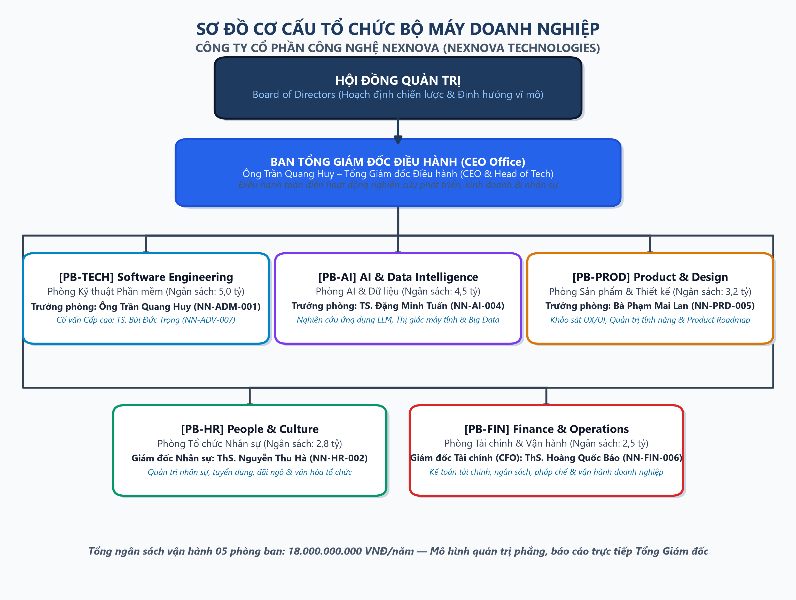
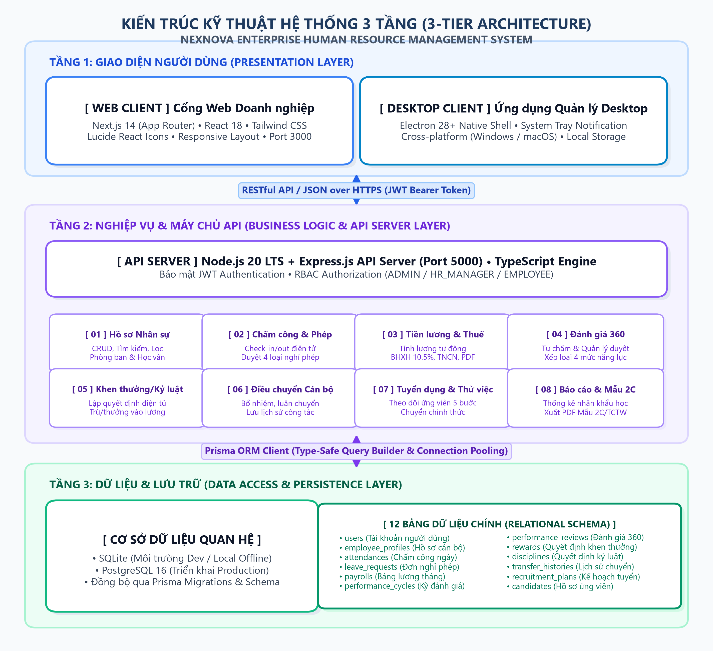

# BÁO CÁO MÔ TẢ HỆ THỐNG THÔNG TIN QUẢN TRỊ NGUỒN NHÂN LỰC
## NEXNOVA ENTERPRISE HRM (PHIÊN BẢN 2.1.0)
**Đơn vị thực hiện:** Công ty Cổ phần Công nghệ NexNova (NexNova Technologies)  
**Thời gian hoàn thành:** Tháng 10/2026  

---

## MỤC LỤC TỔNG QUAN

- [PHẦN I. GIỚI THIỆU TỔNG QUAN VỀ CÔNG TY CỔ PHẦN CÔNG NGHỆ NEXNOVA](#phần-i-giới-thiệu-tổng-quan-về-công-ty-cổ-phần-công-nghệ-nexnova)
  - [1.1. Thông tin chung về doanh nghiệp](#11-thông-tin-chung-về-doanh-nghiệp)
  - [1.2. Tầm nhìn, sứ mệnh và giá trị cốt lõi](#12-tầm-nhìn-sứ-mệnh-và-giá-trị-cốt-lõi)
  - [1.3. Cơ cấu tổ chức bộ máy doanh nghiệp](#13-cơ-cấu-tổ-chức-bộ-máy-doanh-nghiệp)
- [PHẦN II. MÔ HÌNH HOẠT ĐỘNG QUẢN TRỊ NGUỒN NHÂN LỰC](#phần-ii-mô-hình-hoạt-động-quản-trị-nguồn-nhân-lực)
  - [2.1. Mô hình quản trị nhân sự tổng thể](#21-mô-hình-quản-trị-nhân-sự-tổng-thể)
  - [2.2. Các quy trình nghiệp vụ cốt lõi của hệ thống](#22-các-quy-trình-nghiệp-vụ-cốt-lõi-của-hệ-thống)
  - [2.3. Hệ thống phân quyền truy cập người dùng](#23-hệ-thống-phân-quyền-truy-cập-người-dùng)
- [PHẦN III. CÁC PHÂN HỆ QUẢN TRỊ NGUỒN NHÂN LỰC CHI TIẾT](#phần-iii-các-phân-hệ-quản-trị-nguồn-nhân-lực-chi-tiết)
  - [3.1. Phân hệ Hồ sơ Cán bộ & Cổng Tự phục vụ Nhân viên](#31-phân-hệ-hồ-sơ-cán-bộ--cổng-tự-phục-vụ-nhân-viên)
  - [3.2. Phân hệ Quản lý Phòng ban & Định biên Nhân sự](#32-phân-hệ-quản-lý-phòng-ban--định-biên-nhân-sự)
  - [3.3. Phân hệ Quản lý Hợp đồng Lao động & Pháp lý](#33-phân-hệ-quản-lý-hợp-đồng-lao-động--pháp-lý)
  - [3.4. Phân hệ Chấm công & Quản lý Nghỉ phép Điện tử](#34-phân-hệ-chấm-công--quản-lý-nghỉ-phép-điện-tử)
  - [3.5. Phân hệ Tiền lương, Bảo hiểm, Thuế TNCN & Phiếu lương PDF](#35-phân-hệ-tiền-lương-bảo-hiểm-thuế-tncn--phiếu-lương-pdf)
  - [3.6. Phân hệ Đánh giá Hiệu suất Đa chiều theo Trọng số & Hiệu chỉnh Bell-Curve](#36-phân-hệ-đánh-giá-hiệu-suất-đa-chiều-theo-trọng-số--hiệu-chỉnh-bell-curve)
  - [3.7. Phân hệ Khen thưởng & Kỷ luật Lao động](#37-phân-hệ-khen-thưởng--kỷ-luật-lao-động)
  - [3.8. Phân hệ Thuyên chuyển & Điều động Cán bộ](#38-phân-hệ-thuyên-chuyển--điều-động-cán-bộ)
  - [3.9. Phân hệ Tuyển dụng Kanban Pipeline & One-Click Onboarding](#39-phân-hệ-tuyển-dụng-kanban-pipeline--one-click-onboarding)
  - [3.10. Phân hệ Báo cáo Phân tích Nhân sự & Sơ yếu Lý lịch](#310-phân-hệ-báo-cáo-phân-tích-nhân-sự--sơ-yếu-lý-lịch)
- [PHẦN IV. KIẾN TRÚC KỸ THUẬT VÀ CƠ SỞ DỮ LIỆU HỆ THỐNG](#phần-iv-kiến-trúc-kỹ-thuật-và-cơ-sở-dữ-liệu-hệ-thống)
  - [4.1. Sơ đồ kiến trúc tổng thể ba tầng](#41-sơ-đồ-kiến-trúc-tổng-thể-ba-tầng)
  - [4.2. Công nghệ và nền tảng phát triển](#42-công-nghệ-và-nền-tảng-phát-triển)
  - [4.3. Mô hình cơ sở dữ liệu quan hệ (18 Bảng)](#43-mô-hình-cơ-sở-dữ-liệu-quan-hệ-18-bảng)
- [PHẦN V. KẾT LUẬN VÀ PHỤ LỤC TÀI KHOẢN KIỂM THỬ](#phần-v-kết-luận-và-phụ-lục-tài-khoản-kiểm-thử)
  - [5.1. Kết luận và định hướng phát triển](#51-kết-luận-và-định-hướng-phát-triển)
  - [5.2. Danh mục tài khoản kiểm thử hệ thống](#52-danh-mục-tài-khoản-kiểm-thử-hệ-thống)

---

## PHẦN I. GIỚI THIỆU TỔNG QUAN VỀ CÔNG TY CỔ PHẦN CÔNG NGHỆ NEXNOVA

### 1.1. Thông tin chung về doanh nghiệp

Công ty Cổ phần Công nghệ NexNova (tên giao dịch quốc tế: *NexNova Technologies Joint Stock Company*) được thành lập năm 2020, là doanh nghiệp công nghệ tiên phong tại Việt Nam chuyên sâu trong lĩnh vực nghiên cứu, phát triển và cung ứng các giải pháp chuyển đổi số toàn diện, ứng dụng Trí tuệ nhân tạo (Artificial Intelligence - AI) và Hệ thống Quản trị Doanh nghiệp thông minh (Enterprise Software Solutions). 

Trải qua hơn 6 năm xây dựng và phát triển vững chắc, NexNova đã khẳng định vị thế dẫn đầu với đội ngũ nhân sự chất lượng cao gồm hơn 50 chuyên gia công nghệ, tiến sĩ, thạc sĩ và kỹ sư phần mềm cao cấp, phục vụ hàng chục đối tác doanh nghiệp lớn trong và ngoài nước. Trụ sở chính của công ty tọa lạc tại Tầng 18, Tòa nhà NexNova Tower, đường Phạm Văn Đồng, quận Cầu Giấy, thành phố Hà Nội; cùng Văn phòng đại diện phía Nam đặt tại Khu Đô thị Sala, thành phố Thủ Đức, thành phố Hồ Chí Minh.

**Bảng 1.1. Bảng thông tin pháp lý và hành chính của Công ty Cổ phần Công nghệ NexNova**

| Tiêu chí | Thông tin chi tiết |
| :--- | :--- |
| **Tên doanh nghiệp** | Công ty Cổ phần Công nghệ NexNova |
| **Tên quốc tế** | NexNova Technologies Joint Stock Company |
| **Mã số thuế doanh nghiệp** | `0108992834` (Đồng bộ toàn bộ hóa đơn điện tử & hệ thống tính lương) |
| **Năm thành lập** | 2020 |
| **Trụ sở chính** | Tầng 18, Tòa nhà NexNova Tower, Phạm Văn Đồng, Cầu Giấy, Hà Nội |
| **Văn phòng đại diện phía Nam** | Khu Đô thị Sala, Phường An Khánh, TP. Thủ Đức, TP. Hồ Chí Minh |
| **Lĩnh vực hoạt động cốt lõi** | Công nghệ phần mềm, Trí tuệ nhân tạo (AI), Nền tảng quản trị nhân lực HRM |
| **Quy mô lực lượng lao động** | Trên 50 cán bộ nghiên cứu, kỹ sư phần mềm và chuyên viên chính thức |
| **Trang thông tin điện tử** | https://nexnova.tech |
| **Hòm thư điện tử liên hệ** | contact@nexnova.tech |
| **Người đại diện theo pháp luật** | Ông Trần Quang Huy — Giám đốc Điều hành (CEO & CTO) |

### 1.2. Tầm nhìn, sứ mệnh và giá trị cốt lõi

- **Tầm nhìn chiến lược (Vision):** Đến năm 2030, Công ty Cổ phần Công nghệ NexNova định hướng trở thành tập đoàn công nghệ số và trí tuệ nhân tạo hàng đầu khu vực Đông Nam Á, cung cấp hạ tầng phần mềm quản trị doanh nghiệp chuẩn mực quốc tế, lấy tự động hóa và phân tích dữ liệu làm nền tảng thúc đẩy tăng trưởng vượt bậc cho khách hàng.
- **Sứ mệnh phụng sự (Mission):** Nghiên cứu và sáng tạo các sản phẩm công nghệ hiện đại, có tính ứng dụng thực tiễn cao, giúp doanh nghiệp Việt Nam tối ưu hóa chi phí vận hành, giải phóng tiềm năng nhân sự, bảo đảm an toàn dữ liệu và kiến tạo môi trường làm việc hạnh phúc, minh bạch.
- **Giá trị cốt lõi (Core Values):**
  1. *Đổi mới sáng tạo (Innovation):* Không ngừng ứng dụng các công nghệ tiên tiến nhất (Next.js, TypeScript, Cloud Native, Edge Computing, LLM) vào thực tiễn sản phẩm.
  2. *Con người là trọng tâm (Human-centric):* Nhân viên là tài sản quý giá nhất; mọi chính sách, công cụ quản trị đều hướng tới mục tiêu phát triển toàn diện năng lực và đãi ngộ xứng đáng.
  3. *Minh bạch & Liêm chính (Integrity):* Chuẩn hóa mọi quy trình chấm công, tính lương, thưởng phạt, đánh giá KPI công khai, có số liệu minh chứng và tuân thủ tuyệt đối quy định pháp luật.
  4. *Chất lượng & Cam kết (Excellence):* Đặt chuẩn mực cao nhất vào chất lượng sản phẩm phần mềm, độ ổn định hệ thống và dịch vụ hỗ trợ khách hàng nội bộ cũng như đối ngoại.

### 1.3. Cơ cấu tổ chức bộ máy doanh nghiệp

Cơ cấu tổ chức bộ máy của Công ty Cổ phần Công nghệ NexNova được thiết lập theo mô hình quản trị doanh nghiệp hiện đại, tinh gọn và phẳng (Flat Hierarchy). Đứng đầu bộ máy là Hội đồng Quản trị chỉ đạo chiến lược vĩ mô, trực tiếp giao quyền điều hành toàn diện cho Ban Giám đốc Điều hành (do Ông Trần Quang Huy kiêm nhiệm Tổng Giám đốc và Giám đốc Công nghệ). 

Toàn bộ hoạt động sản xuất kinh doanh và nghiên cứu phát triển được tổ chức thành **05 Phòng ban nghiệp vụ cốt lõi** với tổng ngân sách vận hành năm được phê duyệt là **18.000.000.000 VNĐ/năm**:

**Bảng 1.2. Danh mục 05 Phòng ban cốt lõi của Công ty Cổ phần Công nghệ NexNova**

| STT | Mã phòng ban | Tên phòng ban & Vị trí làm việc | Chức năng & Nhiệm vụ cốt lõi | Lãnh đạo phụ trách | Ngân sách năm (VNĐ) |
| :---: | :---: | :--- | :--- | :--- | :---: |
| 1 | `PB-TECH` | **Software Engineering** *(Phòng Kỹ thuật Phần mềm)* Tầng 18, NexNova Tower | Phát triển hệ thống phần mềm lõi, ứng dụng Desktop/Web, kiến trúc Cloud và bảo mật dữ liệu. *(TS. Bùi Đức Trọng `NN-ADV-007` giữ vai trò Cố vấn Công nghệ Cấp cao – Senior Technology Fellow & Advisor trực thuộc khối này)* | **Ông Trần Quang Huy** (`NN-ADM-001` - Trưởng phòng) | 5.000.000.000 |
| 2 | `PB-AI` | **AI & Data Intelligence** *(Phòng AI & Dữ liệu)* Tầng 18, NexNova Tower | Nghiên cứu ứng dụng Mô hình ngôn ngữ lớn (LLM), Xử lý ngôn ngữ tự nhiên, Thị giác máy tính và Phân tích dữ liệu lớn. | **TS. Đặng Minh Tuấn** (`NN-AI-004` - Trưởng phòng) | 4.500.000.000 |
| 3 | `PB-PROD` | **Product & Design** *(Phòng Sản phẩm & Thiết kế)* Tầng 17, NexNova Tower | Nghiên cứu trải nghiệm người dùng UI/UX, quản lý vòng đời sản phẩm, định nghĩa tính năng và xây dựng Product Roadmap. | **Bà Phạm Mai Lan** (`NN-PRD-005` - Trưởng phòng) | 3.200.000.000 |
| 4 | `PB-HR` | **People & Culture** *(Phòng Tổ chức Nhân sự)* Tầng 16, NexNova Tower | Quản trị toàn diện nguồn nhân lực, tuyển dụng, đào tạo, chế độ tiền lương, bảo hiểm xã hội, phúc lợi và phát triển văn hóa tổ chức. | **ThS. Nguyễn Thu Hà** (`NN-HR-002` - Giám đốc Nhân sự) | 2.800.000.000 |
| 5 | `PB-FIN` | **Finance & Operations** *(Phòng Tài chính & Vận hành)* Tầng 16, NexNova Tower | Quản lý tài chính kế toán, lập kế hoạch ngân sách, kiểm soát dòng tiền, quản lý hợp đồng pháp chế và vận hành hạ tầng doanh nghiệp. | **ThS. Hoàng Quốc Bảo** (`NN-FIN-006` - Giám đốc Tài chính) | 2.500.000.000 |
| **Tổng** | | **05 Phòng ban nghiệp vụ** | **Toàn bộ công ty** | **Ban Giám đốc Điều hành** | **18.000.000.000** |

---

## PHẦN II. MÔ HÌNH HOẠT ĐỘNG QUẢN TRỊ NGUỒN NHÂN LỰC

### 2.1. Mô hình quản trị nhân sự tổng thể

Mô hình Quản trị Nguồn Nhân lực Doanh nghiệp NexNova (NexNova Enterprise HRM) được xây dựng dựa trên nguyên lý Quản trị Vốn Nhân lực (Human Capital Management - HCM), bao quát trọn vẹn toàn bộ vòng đời của cán bộ công nhân viên từ thời điểm ứng tuyển cho đến khi nghỉ hưu hoặc thôi việc.

Hệ thống số hóa 100% hồ sơ, chứng từ và quy trình phê duyệt, thay thế hoàn toàn phương thức quản lý thủ công truyền thống bằng văn bản giấy hoặc bảng tính rời rạc. Mọi dữ liệu biến động nhân sự (chấm công, nghỉ phép, hợp đồng, tăng lương, bổ nhiệm, khen thưởng, kỷ luật, đánh giá hiệu suất) được tích hợp trong một cơ sở dữ liệu quan hệ đồng nhất, cho phép dữ liệu kế thừa xuyên suốt giữa các phân hệ nghiệp vụ.

**Cơ chế Tự Động Liên Thông Dữ Liệu Lõi (Cross-Module Data Automation):**
Điểm đột phá trong kiến trúc của NexNova HRM phiên bản 2.1.0 là loại bỏ hoàn toàn các "ốc đảo dữ liệu" (Data Silos) và quy trình nhập liệu lặp lại thủ công:
- *Từ Chấm công (`attendances`) & Nghỉ phép (`leave_requests`) sang Đánh giá Hiệu suất (`review_scores`):* Dữ liệu quẹt thẻ, đi muộn, về sớm, làm nửa ngày và các ngày nghỉ việc riêng không hưởng lương (`UNPAID`) trong kỳ đánh giá được Engine tự động tổng hợp, tính toán **Chỉ số vi phạm chuyên cần ($V$)** và quy đổi thẳng thành điểm gợi ý (1 - 5 sao) kèm chuỗi minh chứng tự động cho tiêu chí Chuyên cần.
- *Từ Kỷ luật lao động (`disciplines`) sang Đánh giá Hiệu suất (`review_scores`):* Các quyết định kỷ luật đang có hiệu lực (`ACTIVE`) tự động tạo trần điểm tối đa (Score Ceiling) cho tiêu chí Tuân thủ nội quy, ngăn ngừa việc nhân sự vi phạm quy chế nghiêm trọng nhưng vẫn được chấm điểm tối đa.
- *Từ Khen thưởng, Kỷ luật & Chấm công sang Bảng lương (`payrolls`):* Số ngày công thực tế, ngày phép hưởng lương, các khoản thưởng nóng/danh hiệu và các khoản khấu trừ phạt vi phạm được tự động liên thông tức thời vào bảng lương tháng, bảo đảm tính minh bạch tuyệt đối và không có sự can thiệp cảm tính.

### 2.2. Các quy trình nghiệp vụ cốt lõi của hệ thống

1. **Quy trình Tuyển dụng & Tiếp nhận (Recruitment & Onboarding):** Lập kế hoạch tuyển dụng $\rightarrow$ Đăng tuyển & Thu nhận hồ sơ $\rightarrow$ Sơ loại hồ sơ $\rightarrow$ Phỏng vấn đa vòng $\rightarrow$ Gửi thư mời nhận việc (Offer Letter) $\rightarrow$ Tiếp nhận thử việc $\rightarrow$ One-Click Onboarding tự động sinh tài khoản, hồ sơ nhân sự và hợp đồng lao động điện tử.
2. **Quy trình Quản lý Hồ sơ & Định biên (Core HR & Org Management):** Quản lý hồ sơ điện tử cán bộ, phân cấp Lãnh đạo/Quản lý/Nhân viên, quản lý định biên vị trí phòng ban và quản lý quan hệ báo cáo trực tiếp (Line Manager).
3. **Quy trình Quản lý Hợp đồng Lao động (Contract Lifecycle):** Quản lý các loại hợp đồng (Thử việc, 1 năm, 3 năm, Không thời hạn, Thời vụ), mức lương đóng bảo hiểm và hệ thống cảnh báo tự động trước 30 ngày khi hợp đồng sắp hết hạn.
4. **Quy trình Chấm công & Quản lý Nghỉ phép (Time & Attendance):** Check-in/Check-out điện tử, tự động gắn nhãn đi muộn (sau 08:45), về sớm (trước 17:00), nửa ngày (dưới 4.0 giờ). Quản lý đơn nghỉ phép điện tử qua 05 loại phép, tự động trừ ngày công và khấu trừ quỹ phép năm theo thuật toán loại trừ thứ Bảy, Chủ nhật.
5. **Quy trình Tính lương, Bảo hiểm & Thuế TNCN (Payroll & Statutory Deductions):** Tổng hợp tự động từ ngày công thực tế, phép hưởng lương, các khoản phụ cấp, cộng tiền thưởng, trừ tiền kỷ luật; áp dụng mức trần bảo hiểm và biểu thuế thu nhập cá nhân lũy tiến 7 bậc; xuất phiếu lương PDF điện tử gửi cho người lao động.
6. **Quy trình Đánh giá Hiệu suất 360 độ (Performance Review & Calibration):** Khởi tạo kỳ đánh giá $\rightarrow$ Nhân viên tự đánh giá (Self-review) $\rightarrow$ Quản lý trực tiếp đánh giá (Manager review) $\rightarrow$ Tính điểm trọng số tự động theo 4 nhóm năng lực & 14 tiêu chí $\rightarrow$ Hiệu chỉnh xếp loại theo đường cong chuẩn Bell-curve Gauss.
7. **Quy trình Biến động Nhân sự (Mobility & Discipline):** Thuyên chuyển phòng ban, bổ nhiệm chức vụ bằng Database Transaction tự động cập nhật mức lương và lưu trữ lịch sử điều động; ban hành quyết định khen thưởng và kỷ luật lao động kết nối tức thời vào bảng lương.
8. **Quy trình Báo cáo & Quy hoạch Nhân sự (HR Analytics):** Báo cáo biến động nhân sự, tỷ lệ nhân khẩu học, cảnh báo xét nâng bậc lương định kỳ (thời gian giữ bậc $\ge 24$ tháng) và cảnh báo tuổi nghỉ hưu trước 2 năm (Nam 62 tuổi, Nữ 60 tuổi).

### 2.3. Hệ thống phân quyền truy cập người dùng

Hệ thống triển khai cơ chế kiểm soát truy cập dựa trên vai trò (Role-Based Access Control - RBAC) kết hợp thuộc tính định danh chức vụ (`isCadre`, `cadreType`):

**Bảng 2.1. Ma trận phân quyền truy cập chức năng hệ thống NexNova HRM**

| Chức năng / Phân hệ | Quản trị viên Tối cao (`ADMIN`) | Quản lý Nhân sự (`HR_MANAGER`) | Nhân viên chuyên môn (`EMPLOYEE`) |
| :--- | :---: | :---: | :---: |
| **Quản trị người dùng & Phân quyền hệ thống** | Toàn quyền (CRUD) | Không có quyền | Không có quyền |
| **Quản lý Danh mục Phòng ban & Ngân sách** | Toàn quyền (CRUD) | Xem, cập nhật định biên | Xem cơ cấu tổ chức |
| **Quản lý Hồ sơ Cán bộ toàn công ty** | Toàn quyền (CRUD) | Toàn quyền (CRUD) | Chỉ xem hồ sơ cá nhân |
| **Cổng Tự phục vụ Nhân viên (ESS Profile)** | Xem và hiệu chỉnh | Xem và hiệu chỉnh | Xem 5 tab hồ sơ của mình |
| **Quản lý Hợp đồng Lao động** | Phê duyệt, ký số | Soạn thảo, theo dõi gia hạn | Xem hợp đồng của mình |
| **Chấm công & Điểm danh hàng ngày** | Toàn quyền tra cứu | Quản lý bảng công toàn công ty | Thực hiện Check-in / Check-out |
| **Phê duyệt Đơn xin nghỉ phép** | Phê duyệt cấp cao | Phê duyệt cấp phòng/toàn bộ | Tạo đơn xin nghỉ cá nhân |
| **Tính toán & Khóa sổ Bảng lương** | Phê duyệt, thanh toán | Lập bảng lương, tính bảo hiểm/thuế | Xem & Tải phiếu lương PDF |
| **Thiết lập Tiêu chí & Kỳ đánh giá KPI** | Phê duyệt kỳ đánh giá | Thiết lập mẫu KPI, mở kỳ đánh giá | Tự đánh giá (Self-review) |
| **Đánh giá Hiệu suất Cán bộ (Manager Review)** | Đánh giá Trưởng phòng | Đánh giá nhân sự khối HR | Đánh giá cấp dưới (nếu là Manager) |
| **Khen thưởng & Kỷ luật Lao động** | Ký duyệt quyết định | Lập tờ trình đề xuất | Xem quyết định cá nhân |
| **Thuyên chuyển & Bổ nhiệm Cán bộ** | Ký duyệt quyết định | Soạn thảo quyết định điều chuyển | Xem lịch sử thuyên chuyển |
| **Tuyển dụng & Onboarding Ứng viên** | Xem báo cáo tuyển dụng | Quản lý Pipeline, One-click Onboard | Không có quyền |
| **Báo cáo Phân tích & Trích xuất Lý lịch** | Toàn quyền tra cứu | Toàn quyền phân tích, in mẫu 2C | Không có quyền |

---

## PHẦN III. CÁC PHÂN HỆ QUẢN TRỊ NGUỒN NHÂN LỰC CHI TIẾT

### 3.1. Phân hệ Hồ sơ Cán bộ & Cổng Tự phục vụ Nhân viên

Phân hệ Hồ sơ Cán bộ là hạt nhân lưu trữ toàn bộ dữ liệu định danh, chuyên môn, tiền lương và pháp lý của người lao động. 

- **Quy tắc sinh Mã số cán bộ (`Employee Code`):** Chuẩn hóa theo cấu trúc `NN-[MÃ_PHÒNG]-[SỐ_THỨ_TỰ]` (Ví dụ: `NN-ADM-001` cho Lãnh đạo điều hành, `NN-HR-002` cho Nhân sự, `NN-ENG-003` cho Kỹ thuật, `NN-AI-004` cho Trí tuệ nhân tạo, `NN-PRD-005` cho Sản phẩm, `NN-FIN-006` cho Tài chính, `NN-ADV-007` cho Cố vấn cấp cao).
- **Phân loại Cán bộ Quản lý và Nhân viên:** Hệ thống lưu trữ cờ `isCadre` (Boolean) và phân cấp rõ `cadreType`:
  - `LEADERSHIP`: Cán bộ Lãnh đạo (Tổng Giám đốc, Giám đốc khối, Trưởng phòng).
  - `MANAGEMENT`: Cán bộ Quản lý (Phó phòng, Trưởng nhóm chuyên môn, Tech Lead).
  - `STAFF`: Nhân viên chuyên môn, kỹ sư và chuyên viên thực thi.
  - Quan hệ báo cáo trực tiếp được quản trị thông qua trường `lineManagerId` liên kết đệ quy (`self-relation`) tới hồ sơ của cấp trên quản lý.
- **Cổng Hồ sơ Cá nhân Tự phục vụ (Employee Self-Service - `/dashboard/profile`):** Được thiết kế theo chuẩn B2B SaaS hiện đại với giao diện phẳng, phân chia thành 05 tab thông tin chuyên biệt:
  1. *Tab 1: Công việc & Tổ chức:* Hiển thị Mã cán bộ, Chức vụ hiện tại, Phòng ban trực thuộc, Cấp bậc cán bộ (`cadreType`), Người quản lý trực tiếp (`lineManager`), Ngày gia nhập công ty, Trình độ học vấn cao nhất.
  2. *Tab 2: Định danh & Ngân hàng:* Số Căn cước công dân (CCCD), Ngày cấp, Nơi cấp; Mã số thuế cá nhân (MST); Mã số sổ Bảo hiểm Xã hội (BHXH); Số tài khoản ngân hàng, Tên ngân hàng thụ hưởng (Vietcombank, Techcombank, MB Bank...), Tên chi nhánh.
  3. *Tab 3: Hợp đồng Lao động:* Hiển thị số hợp đồng hiệu lực gần nhất, Loại hợp đồng, Thời hạn, Mức lương đóng bảo hiểm và trạng thái hợp đồng.
  4. *Tab 4: Quỹ phép năm & Đãi ngộ:* Thống kê Quỹ phép năm tổng thể (mặc định 12 ngày/năm), Số ngày phép đã sử dụng, Số ngày phép còn lại khả dụng (`annualLeaveBalance`) và các chế độ đãi ngộ nội bộ.
  5. *Tab 5: Lương & Thu nhập:* Thông tin Mức lương cơ bản thỏa thuận, Mức phụ cấp cố định, Lịch sử tăng lương gần nhất và liên kết xem chi tiết các kỳ lương.

### 3.2. Phân hệ Quản lý Phòng ban & Định biên Nhân sự

Giao diện quản lý phòng ban (`/dashboard/departments`) cung cấp cái nhìn trực quan và số hóa toàn diện về cơ cấu tổ chức doanh nghiệp:

- **Quản lý Danh mục Phòng ban & Định biên:** Thiết lập thông tin định danh của từng phòng ban gồm Mã phòng ban (`code`), Tên phòng ban (`name`), Chức năng mô tả (`description`), Vị trí tầng làm việc (`location`), Thứ tự sắp xếp hiển thị (`sortOrder`).
- **Quản lý Ngân sách Hoạt động Năm:** Phân bổ ngân sách vận hành chi tiết cho từng đơn vị (Tổng quỹ ngân sách công ty là 18.000.000.000 VNĐ, trong đó Khối Kỹ thuật phần mềm chiếm 5,0 tỷ, Khối AI chiếm 4,5 tỷ, Khối Sản phẩm chiếm 3,2 tỷ, Khối Nhân sự chiếm 2,8 tỷ, Khối Tài chính chiếm 2,5 tỷ).
- **Bổ nhiệm Lãnh đạo Phòng ban:** Quản lý thông tin bổ nhiệm Trưởng phòng (`managerId`) và Phó phòng (`deputyId`), liên kết trực tiếp tới hồ sơ `EmployeeProfile`.
- **Phân tách Cơ cấu Nhân sự:** Hệ thống tự động phân tách và thống kê cơ cấu nhân sự của từng phòng ban thành 02 khối rõ rệt: *Khối Cán bộ Lãnh đạo & Quản lý* (`isCadre = true`) và *Khối Nhân viên Chuyên môn* (`isCadre = false`), hỗ trợ đắc lực cho công tác quy hoạch nguồn cán bộ kế cận.
- **Biểu đồ Cây Tổ chức Trực quan (Interactive Org Chart):** Tích hợp sơ đồ dạng cây cho phép xem mối liên kết báo cáo và phân cấp phòng ban trong toàn công ty.

### 3.3. Phân hệ Quản lý Hợp đồng Lao động & Pháp lý

Phân hệ Quản lý Hợp đồng (`/dashboard/contracts`) chịu trách nhiệm chuẩn hóa mặt pháp lý giữa người lao động và doanh nghiệp theo Bộ luật Lao động Việt Nam:

- **Quản lý Vòng đời Hợp đồng:** Theo dõi 05 loại hình hợp đồng lao động:
  1. `PROBATION`: Hợp đồng thử việc (thời hạn 1 đến 3 tháng).
  2. `DEFINITE_1Y`: Hợp đồng lao động xác định thời hạn 01 năm (12 tháng).
  3. `DEFINITE_3Y`: Hợp đồng lao động xác định thời hạn 03 năm (36 tháng).
  4. `INDEFINITE`: Hợp đồng lao động không xác định thời hạn.
  5. `SEASONAL`: Hợp đồng cộng tác viên / thời vụ theo dự án.
- **Thông tin Pháp lý & Tài chính Hợp đồng:** Mỗi hợp đồng lưu trữ Mã số hợp đồng duy nhất (chuẩn `HĐLĐ-[NĂM]/[STT]`, ví dụ: `HĐLĐ-2026/001`), Chức danh công việc ký kết, Ngày bắt đầu hiệu lực, Ngày kết thúc hiệu lực, Ngày ký, Thời giờ làm việc tiêu chuẩn (40 giờ/tuần), Trạng thái hợp đồng (`ACTIVE` - Có hiệu lực, `EXPIRED` - Hết hạn, `TERMINATED` - Chấm dứt hợp đồng).
- **Mức lương Đóng Bảo hiểm Xã hội (`salaryInsurance`):** Quản lý mức tiền lương làm căn cứ trích đóng BHXH, BHYT, BHTN theo quy định (thông thường bằng 80% đến 100% mức lương cơ bản).
- **Hệ thống Cảnh báo Tự động Hợp đồng Sắp hết hạn:** Hệ thống tự động quét dữ liệu mỗi ngày và kích hoạt thẻ cảnh báo màu vàng trên Trung tâm Điều hành Nhân sự đối với các hợp đồng **còn hiệu lực dưới 30 ngày**, nhắc nhở chuyên viên nhân sự tiến hành đánh giá tái ký hoặc thanh lý hợp đồng đúng thời hạn luật định.

### 3.4. Phân hệ Chấm công & Quản lý Nghỉ phép Điện tử

Phân hệ Chấm công & Nghỉ phép (`/dashboard/attendance`) giải quyết bài toán quản trị thời gian làm việc chính xác và tự động:

- **Mốc giờ Chấm công Chuẩn mực (theo `attendance.service.ts`):**
  - Giờ làm việc tiêu chuẩn: Từ **08:30 đến 17:30** từ Thứ Hai đến Thứ Sáu (nghỉ trưa từ 12:00 đến 13:00).
  - *Đi muộn (LATE):* Nhân viên thực hiện Check-in sau **08:45** (cho phép 15 phút ân hạn) sẽ bị hệ thống tự động đánh dấu trạng thái `LATE`.
  - *Về sớm (EARLY_LEAVE):* Nhân viên thực hiện Check-out trước **17:00** sẽ bị tự động đánh dấu trạng thái `EARLY_LEAVE`.
  - *Nửa ngày công (HALF_DAY):* Nếu tổng thời gian làm việc thực tế trong ngày dưới **4.0 giờ**, bản ghi công được gắn nhãn `HALF_DAY` (tương ứng 0.5 ngày công).
  - *Đủ ngày công (PRESENT):* Tổng thời gian làm việc từ 4.0 giờ đến 8.0 giờ (hoặc hơn) và không vi phạm quy định nghiêm trọng được tính đủ 1.0 ngày công.
- **Quản lý 05 Loại hình Nghỉ phép:**
  1. `ANNUAL`: Nghỉ phép năm có hưởng 100% lương (hạn mức mặc định 12 ngày/năm cho nhân viên chính thức).
  2. `SICK`: Nghỉ ốm đau có xác nhận của cơ sở y tế (hưởng trợ cấp BHXH).
  3. `MATERNITY`: Nghỉ thai sản theo quy định luật BHXH.
  4. `COMPASSIONATE`: Nghỉ hiếu, hỷ có hưởng lương (kết hôn, tang chế tứ thân phụ mẫu).
  5. `UNPAID`: Nghỉ việc riêng không hưởng lương.
- **Thuật toán Đếm Ngày làm việc (`countBusinessDays`):**
  - Khi nhân viên gửi đơn nghỉ phép trong khoảng từ ngày $D_{start}$ đến $D_{end}$, hàm `countBusinessDays` tự động lặp qua từng ngày và **loại trừ các ngày Thứ Bảy và Chủ Nhật**.
  - Khi đơn xin nghỉ phép năm (`ANNUAL`) được người có thẩm quyền phê duyệt (`APPROVED`), hệ thống tự động khấu trừ số ngày nghỉ tương ứng vào quỹ phép còn lại (`annualLeaveBalance`) của nhân viên.
  - Trường hợp đơn bị từ chối hoặc người lao động thu hồi đơn, hệ thống tự động hoàn trả lại đúng số ngày phép đã trừ.

### 3.5. Phân hệ Tiền lương, Bảo hiểm, Thuế TNCN & Phiếu lương PDF

Phân hệ Tiền lương (`/dashboard/payroll`) thực hiện tự động hóa 100% quy trình tính toán lương, bảo hiểm và nghĩa vụ thuế thu nhập cá nhân:

- **Quy tắc Tính Ngày công & Lương Thời gian:**
  $$\text{Ngày công tính lương} = \min\left(22, \text{actualWorkDays} + \text{paidLeaveDays}\right)$$
  Lương thực nhận theo ngày công được tính dựa trên tỷ lệ ngày công thực tế (cộng dồn ngày nghỉ phép hưởng nguyên lương) chia cho số ngày làm việc tiêu chuẩn trong tháng (chuẩn 22 ngày).
- **Mức trần Đóng Bảo hiểm Xã hội, Y tế & Thất nghiệp:**
  - *Mức trần BHXH và BHYT:* Theo Nghị định Chính phủ, mức lương đóng tối đa bằng 20 lần mức lương cơ sở ($20 \times 2.340.000 = \mathbf{46.800.000\text{ VNĐ}}$).
  - *Mức trần BHTN:* Bằng 20 lần mức lương tối thiểu vùng I ($20 \times 4.960.000 = \mathbf{99.200.000\text{ VNĐ}}$).
  - *Tỷ lệ trích nộp phần người lao động:* Tổng cộng **10.5%**, trong đó: BHXH trích **8.0%**, BHYT trích **1.5%**, BHTN trích **1.0%**.
- **Thuật toán Tính Thuế Thu nhập Cá nhân (TNCN) Lũy tiến 7 Bậc:**
  - Giảm trừ gia cảnh bản thân: **11.000.000 VNĐ/tháng**.
  - Giảm trừ người phụ thuộc: **4.400.000 VNĐ/người/tháng**.
  - Thu nhập tính thuế = Thu nhập chịu thuế (Lương + Phụ cấp + Thưởng) - Các khoản bảo hiểm bắt buộc - Giảm trừ gia cảnh.
  - Biểu thuế lũy tiến từng phần 7 bậc được tính chính xác theo công thức:
    - Bậc 1 (Đến 5 triệu VNĐ): $5\%$
    - Bậc 2 (Trên 5 đến 10 triệu VNĐ): $10\% - 0.25\text{ tr}$
    - Bậc 3 (Trên 10 đến 18 triệu VNĐ): $15\% - 0.75\text{ tr}$
    - Bậc 4 (Trên 18 đến 32 triệu VNĐ): $20\% - 1.65\text{ tr}$
    - Bậc 5 (Trên 32 đến 52 triệu VNĐ): $25\% - 3.25\text{ tr}$
    - Bậc 6 (Trên 52 đến 80 triệu VNĐ): $30\% - 5.85\text{ tr}$
    - Bậc 7 (Trên 80 triệu VNĐ): $35\% - 9.85\text{ tr}$
- **Tích hợp Tự động với Khen thưởng & Kỷ luật:**
  - Mọi quyết định khen thưởng có giá trị tiền tệ trong tháng tự động cộng vào khoản mục `rewardAmount`.
  - Mọi quyết định kỷ luật có phạt tiền tự động khấu trừ vào khoản mục `deductions`.
- **Trích xuất Phiếu lương PDF Chuẩn Doanh nghiệp:** Tích hợp thư viện `PDFKit` phía Backend trích xuất phiếu lương song ngữ, đầy đủ thông tin pháp lý doanh nghiệp (Mã số thuế `0108992834`), chi tiết từng khoản thu nhập, khấu trừ bảo hiểm, thuế TNCN và lương thực lĩnh (Net Salary).

### 3.6. Phân hệ Đánh giá Hiệu suất Đa chiều theo Trọng số & Hiệu chỉnh Bell-Curve

Phân hệ Đánh giá Hiệu suất (`/dashboard/performance`) cung cấp công cụ đo lường kết quả công tác và năng lực cán bộ chuẩn mực quốc tế:

- **Quy trình Đánh giá 360 độ:** Nhân viên tiến hành Tự đánh giá (`selfScore`) $\rightarrow$ Cán bộ quản lý trực tiếp thực hiện đánh giá độc lập (`mgrScore`) $\rightarrow$ Hệ thống tự động tính toán điểm số tổng hợp theo trọng số danh mục.
- **Bộ Tiêu chí Đánh giá Chuẩn Doanh nghiệp NexNova 2026 (4 Nhóm Năng lực & 14 Tiêu chí):**

**Bảng 3.1. Bộ tiêu chí đánh giá năng lực và hiệu suất công tác chuẩn NexNova 2026**

| Nhóm năng lực | Trọng số nhóm | STT | Tiêu chí đánh giá thành phần | Trọng số tiêu chí | Thang điểm |
| :--- | :---: | :---: | :--- | :---: | :---: |
| **I. Kết quả Công việc** *(Work Output)* | **50%** | 1 | Hoàn thành mục tiêu OKRs / KPIs giao đầu kỳ | 40% | 1.0 – 5.0 |
| | | 2 | Chất lượng sản phẩm, dịch vụ và mã nguồn | 30% | 1.0 – 5.0 |
| | | 3 | Tiến độ hoàn thành và kỹ năng quản lý thời gian | 20% | 1.0 – 5.0 |
| | | 4 | Sáng kiến cải tiến kỹ thuật và quy trình làm việc | 10% | 1.0 – 5.0 |
| **II. Năng lực Chuyên môn** *(Technical Competency)* | **20%** | 5 | Kiến thức nghiệp vụ và chuyên môn kỹ thuật sâu | 40% | 1.0 – 5.0 |
| | | 6 | Năng lực giải quyết các vấn đề kỹ thuật phức tạp | 35% | 1.0 – 5.0 |
| | | 7 | Tinh thần tự học, nghiên cứu và làm chủ công nghệ | 25% | 1.0 – 5.0 |
| **III. Năng lực Hành vi & Văn hóa** *(Behavioral Competency)* | **20%** | 8 | Tinh thần làm việc nhóm và phối hợp liên phòng ban | 30% | 1.0 – 5.0 |
| | | 9 | Kỹ năng giao tiếp, truyền đạt và báo cáo minh bạch | 25% | 1.0 – 5.0 |
| | | 10 | Năng lực lãnh đạo, truyền cảm hứng và cố vấn (Mentoring) | 25% | 1.0 – 5.0 |
| | | 11 | Tư duy sáng tạo, đổi mới và thích ứng linh hoạt | 20% | 1.0 – 5.0 |
| **IV. Kỷ luật & Thái độ** *(Discipline & Attitude)* | **10%** | 12 | Tính chuyên cần, đúng giờ và tuân thủ nội quy lao động | 40% | 1.0 – 5.0 |
| | | 13 | Tuân thủ an toàn thông tin, bảo mật mã nguồn và tài sản | 30% | 1.0 – 5.0 |
| | | 14 | Tinh thần trách nhiệm, đạo đức nghề nghiệp và phụng sự | 30% | 1.0 – 5.0 |
| **Tổng cộng** | **100%** | | **14 tiêu chí chuẩn hóa** | **100%** | |

- **Mô hình Đa Bộ Tiêu Chí KPI Phân Hóa theo Cấp bậc & Khối Phòng ban:**
  Nhằm khắc phục nhược điểm của việc áp dụng cào bằng một bộ tiêu chí duy nhất cho toàn thể cán bộ nhân viên, hệ thống NexNova HRM đã nâng cấp lên kiến trúc **Đa Khung Tiêu Chí Đánh Giá Chuyên Biệt (Multi-Template KPI Architecture)**. Dịch vụ phân tích tự động `resolveTemplateForEmployee` căn cứ vào Cấp bậc cán bộ (`isCadre`, `cadreType`) và Mã phòng ban (`departmentRef.code` hoặc tên đơn vị) để tự động định tuyến nhân sự vào khung đánh giá phù hợp nhất. Toàn bộ các bộ tiêu chí đều quy chuẩn trọng số về 100% và chuẩn hóa trên **thang điểm 5.00** để phục vụ phiên họp hiệu chỉnh tập trung của Hội đồng Đánh giá / Ban Giám đốc (Bell-curve Calibration):

**Bảng 3.1.b. Ma trận phân hóa 04 Bộ tiêu chí KPI theo Cấp bậc và Khối phòng ban chuyên môn**

| STT | Tên Bộ Tiêu Chí KPI | Đối tượng áp dụng (`targetRole` / `targetDepartment`) | Cấu trúc 4 Nhóm năng lực & Trọng số phân bổ | Tiêu chí trọng tâm tiêu biểu | Quy chuẩn thang điểm |
| :---: | :--- | :--- | :--- | :--- | :---: |
| 1 | **Khung Đánh Giá Chuẩn Toàn Công Ty** *(NexNova Standard KPI)* | Áp dụng mặc định `ALL` / `ALL` *(isDefault: true)* | • Kết quả công việc: **50%** • Năng lực chuyên môn: **20%** • Năng lực hành vi: **20%** • Kỷ luật & Thái độ: **10%** | Hoàn thành OKRs (40%), Chất lượng sản phẩm (30%), Tiến độ (20%), Cải tiến kỹ thuật (10%). | **5.00 Điểm** *(Chuẩn hóa)* |
| 2 | **Khung Quản Trị & Lãnh Đạo** *(Leadership & Management KPI)* | Ban Lãnh đạo, Trưởng/Phó phòng ban, Quản lý cấp cao `CADRE` / `ALL` | • Mục tiêu Phòng ban: **45%** • Quản trị & Chiến lược: **30%** • Năng lực Chuyên môn: **15%** • Văn hóa & Quản trị rủi ro: **10%** | Tỷ lệ hoàn thành KPI bộ phận (40%), Tiến độ dự án trọng điểm (35%), Mentoring & Giữ chân nhân tài (35%), Hoạch định chiến lược (35%). | **5.00 Điểm** *(Chuẩn hóa)* |
| 3 | **Khung Kỹ Sư Phần Mềm, AI & Dữ Liệu** *(Engineering & AI KPI)* | Kỹ sư Công nghệ, AI & Khoa học Dữ liệu `STAFF` / `PB-TECH, PB-AI` | • Engineering Output: **50%** • Technical Mastery: **25%** • Phối hợp Agile: **15%** • Kỷ luật & DevSecOps: **10%** | Hoàn thành Sprint OKRs (40%), Chất lượng Code & Uptime (35%), Làm chủ công nghệ lõi & Debug (45%), Code Review & Agile (50%). | **5.00 Điểm** *(Chuẩn hóa)* |
| 4 | **Khung Sản Phẩm & Vận Hành Doanh Nghiệp** *(Product & Operations KPI)* | Chuyên viên Khối Sản phẩm, Nhân sự & Tài chính `STAFF` / `PB-PROD, PB-HR, PB-FIN` | • Thực thi Nghiệp vụ: **50%** • Nghiệp vụ Chuyên môn: **20%** • Hợp tác Dịch vụ Nội bộ: **15%** • Pháp chế, Bảo mật: **15%** | Hoàn thành chỉ tiêu SLA (40%), Độ chính xác hồ sơ/thiết kế (35%), Am hiểu pháp lý & giải quyết vấn đề (45%), Bảo mật dữ liệu tuyệt đối (60%). | **5.00 Điểm** *(Chuẩn hóa)* |

- **Bảng 5 Mức Xếp loại Năng lực & Tỷ lệ Phân bổ Chuẩn (Bell-curve Calibration):**
  Hệ thống áp dụng thuật toán hiệu chỉnh phân phối Gauss để ngăn ngừa tình trạng đánh giá cảm tính hoặc cào bằng:

**Bảng 3.2. Khung xếp loại đánh giá hiệu suất và tỷ lệ phân bổ đường cong chuẩn Bell-curve**

| Mức xếp loại | Mã xếp loại | Khoảng điểm tổng hợp | Tỷ lệ phân bổ chuẩn (Bell-curve) | Hướng xử lý nhân sự & Đãi ngộ |
| :--- | :---: | :---: | :---: | :--- |
| **Xuất sắc** | `EXCELLENT / A+` | **4.50 – 5.00** | **10% – 15%** | Thưởng hiệu suất tối đa, quy hoạch cán bộ nguồn, xét tăng lương vượt bậc |
| **Tốt** | `GOOD / A` | **3.80 – 4.49** | **25% – 30%** | Thưởng hiệu suất định kỳ, xét nâng bậc lương đúng niên hạn |
| **Đạt yêu cầu** | `AVERAGE / B` | **3.00 – 3.79** | **40% – 50%** | Hoàn thành nhiệm vụ, duy trì mức thu nhập và vị trí công tác hiện tại |
| **Cần cải thiện** | `NEEDS_IMPROVEMENT / C` | **2.00 – 2.99** | **5% – 10%** | Đưa vào chương trình đào tạo nâng cao (PIP), theo dõi sát sao trong 3 tháng |
| **Không đạt** | `UNSATISFACTORY / D` | **< 2.00** | **< 5%** | Xem xét điều chuyển vị trí công tác hoặc chấm dứt hợp đồng lao động |

- **Cơ chế Tự Động Đối Soát & Quy Đổi Chấm Công, Nghỉ Phép & Kỷ Luật Lao Động Sang Điểm KPI (Automated Attendance & Discipline Integration Engine):**
  Để loại bỏ triệt để tính chủ quan, cảm tính trong việc chấm điểm tiêu chí thuộc nhóm *IV. Kỷ luật & Thái độ (Discipline & Attitude)*, NexNova HRM tích hợp thuật toán đối soát tự động từ các phân hệ dữ liệu lõi với quy tắc định lượng chính xác:

  1. **Công thức toán học tính Chỉ số vi phạm chuyên cần ($V$):**
     $$V = (N_{\text{late/early}} \times 1.0) + (N_{\text{half\_day}} \times 0.5) + (N_{\text{unpaid\_leave}} \times 1.5)$$
     *Trong đó:*
     - $N_{\text{late/early}}$ (`lateOrEarlyCount`): Số lần đi muộn (sau 08:45) hoặc về sớm (trước 17:00) trong kỳ đánh giá. Hệ số vi phạm: $1.0$.
     - $N_{\text{half\_day}}$ (`halfDayCount`): Số buổi làm việc nửa ngày (tổng thời gian làm việc thực tế dưới 4.0 giờ). Hệ số vi phạm: $0.5$.
     - $N_{\text{unpaid\_leave}}$ (`unpaidLeaveDays`): Tổng số ngày nghỉ việc riêng không hưởng lương (`leaveType === 'UNPAID'` có trạng thái `APPROVED`). Hệ số vi phạm: $1.5$.

  2. **Thang quy đổi Điểm Chuyên cần Đề xuất (`suggestedAttendanceScore`):**
     Căn cứ vào giá trị của Chỉ số vi phạm $V$, hệ thống tự động quy đổi sang thang điểm 1 đến 5 sao:
     - $V = 0 \implies \mathbf{5.0\text{ sao}}$ (Chuyên cần tuyệt đối, không có vi phạm).
     - $0 < V \le 2 \implies \mathbf{4.0\text{ sao}}$ (Chấp hành tốt, vi phạm rất nhẹ).
     - $2 < V \le 5 \implies \mathbf{3.0\text{ sao}}$ (Mức độ trung bình khá).
     - $5 < V \le 8 \implies \mathbf{2.0\text{ sao}}$ (Cần chấn chỉnh giờ giấc làm việc).
     - $V > 8 \implies \mathbf{1.0\text{ sao}}$ (Vi phạm nghiêm trọng kỷ luật giờ giấc).

  3. **Tự động sinh chuỗi minh chứng đối soát Chấm công (`attendanceEvidence`):**
     Hệ thống tự động kết xuất chuỗi văn bản minh chứng có tính pháp lý kỹ thuật:
     `"[Đối soát Chấm công tự động]: Đã điểm danh ${totalCheckIns} buổi | Đi muộn/Về sớm: ${lateOrEarlyCount} lần | Nghỉ không lương: ${unpaidLeaveDays} ngày -> Điểm quy đổi hệ thống: ${suggestedAttendanceScore}/5 sao."`

  4. **Cơ chế Khống chế Trần điểm Kỷ luật Lao động (`suggestedDisciplineScore`):**
     Hệ thống tự động rà soát bảng `disciplines` của nhân sự trong trạng thái đang có hiệu lực (`ACTIVE`):
     - Nếu không có quyết định kỷ luật nào đang hiệu lực: Gợi ý trần điểm $\mathbf{5.0\text{ sao}}$. Minh chứng: `"[Đối soát Kỷ luật tự động]: Chấp hành tốt nội quy, 0 vi phạm kỷ luật đang có hiệu lực."`
     - Nếu có quyết định kỷ luật hình thức chứa *"Buộc thôi việc"*: Khống chế trần điểm tối đa $\mathbf{1.0\text{ sao}}$.
     - Nếu có quyết định kỷ luật hình thức chứa *"Cảnh cáo"* hoặc *"Hạ bậc"*: Khống chế trần điểm tối đa $\mathbf{2.0\text{ sao}}$.
     - Các hình thức kỷ luật khác (*"Khiển trách"*): Khống chế trần điểm tối đa $\mathbf{3.0\text{ sao}}$.
     - Chuỗi cảnh báo minh chứng: `"[Cảnh báo Kỷ luật tự động]: Có ${N} quyết định kỷ luật (${Số QĐ} - ${Hình thức}: ${Lý do}) -> Trần điểm tối đa: ${suggestedDisciplineScore}/5 sao."`

  5. **Cơ chế Pre-fill và Tương tác 1-Click trên Giao diện:**
     - Tại Backend: Khi khởi tạo bản ghi đánh giá hoặc truy vấn review (`getEmployeeReview`, `getReviewsByCycle`), hệ thống tự động điền sẵn (`pre-fill`) điểm số và nhận xét minh chứng vào các tiêu chí chứa từ khóa *"Chuyên cần"*, *"Giờ giấc"*, *"Tuân thủ nội quy"*, *"Bảo mật"*, *"An toàn"*, *"Kỷ luật"*.
     - Tại Frontend: Hiển thị Banner đối soát thông minh tại nhóm tiêu chí thứ 4 ở cả Tab *Tự đánh giá* của nhân viên và Modal *Chấm Điểm Đối Chiếu 2 Chiều* của Quản lý, kèm nút *"Áp Dụng Điểm Đối Soát Tự Động"* giúp đồng bộ dữ liệu tức thì.

### 3.7. Phân hệ Khen thưởng & Kỷ luật Lao động

Phân hệ Khen thưởng & Kỷ luật (`/dashboard/rewards`) quản lý tính nghiêm minh và chế độ đãi ngộ danh dự trong tổ chức:

- **Quản lý Quyết định Khen thưởng:** Lưu trữ Số quyết định, Danh hiệu thi đua (Bằng khen, Giấy khen, Thưởng nóng, Chiến sĩ thi đua cấp cơ sở), Số tiền thưởng, Ngày ban hành quyết định, Lý do thành tích.
- **Quản lý Quyết định Kỷ luật:** Lưu trữ Số quyết định kỷ luật, Hình thức xử lý (Khiển trách miệng, Khiển trách bằng văn bản, Cảnh cáo, Hạ bậc lương, Buộc thôi việc), Số tiền phạt chế tài vi phạm, Ngày hiệu lực, Lý do vi phạm, Trạng thái quyết định (`ACTIVE` - Đang có hiệu lực thi hành, `EXPIRED` - Hết thời hạn kỷ luật).
- **Liên kết Tự động với Tiền lương:** Hệ thống tự động đẩy dữ liệu thưởng/phạt vào kỳ tính lương tương ứng tại thời điểm quyết định có hiệu lực, bảo đảm minh bạch tuyệt đối.

### 3.8. Phân hệ Thuyên chuyển & Điều động Cán bộ

Phân hệ Thuyên chuyển (`/dashboard/transfers`) theo dõi mọi biến động về nhân sự giữa các bộ phận trong doanh nghiệp:

- **Cơ chế Giao dịch Cơ sở dữ liệu Toàn vẹn (Database Transaction):** Khi người có thẩm quyền phê duyệt một quyết định điều chuyển cán bộ, hệ thống sử dụng `prisma.$transaction` để thực thi đồng thời hai thao tác nguyên tử:
  1. Ghi lại bản ghi lịch sử vào bảng `transfer_histories` (bao gồm Số quyết định, Phòng ban cũ, Phòng ban mới, Chức danh cũ, Chức danh mới, Mức lương cũ, Mức lương mới, Ngày hiệu lực điều chuyển và Ghi chú phê duyệt).
  2. Tự động cập nhật trực tiếp vào bản ghi `EmployeeProfile` tương ứng: Cập nhật trường `department`, `departmentId`, `position`, `baseSalary`.
- Đảm bảo lịch sử công tác của nhân viên được bảo toàn 100%, không bị sai lệch dữ liệu qua thời gian.

### 3.9. Phân hệ Tuyển dụng Kanban Pipeline & One-Click Onboarding

Phân hệ Tuyển dụng (`/dashboard/recruitment`) số hóa toàn diện quy trình thu hút nhân tài:

- **Kế hoạch Tuyển dụng (Recruitment Plan):** Lập kế hoạch theo từng phòng ban, Vị trí tuyển dụng, Số lượng định biên cần tuyển, Yêu cầu kỹ năng chuyên môn, Hạn chót nộp hồ sơ (`deadline`), Trạng thái kế hoạch (`OPEN`, `IN_PROGRESS`, `CLOSED`).
- **Phễu Tuyển dụng 6 Trạng thái (Kanban Pipeline):**
  1. `APPLIED`: Tiếp nhận và sàng lọc hồ sơ ứng viên ban đầu.
  2. `INTERVIEWING`: Tổ chức phỏng vấn chuyên môn và đánh giá văn hóa.
  3. `OFFERED`: Gửi thư mời nhận việc và thỏa thuận lương thưởng.
  4. `PROBATION`: Tiếp nhận ứng viên vào giai đoạn thử việc chính thức.
  5. `HIRED`: Hoàn thành thử việc xuất sắc, trở thành nhân viên chính thức.
  6. `REJECTED`: Ứng viên không phù hợp hoặc từ chối đề nghị tuyển dụng.
- **Tính năng Tiếp nhận Nhân sự Một Chạm (One-Click Onboarding):**
  Khi ứng viên được chuyển sang trạng thái sẵn sàng tiếp nhận, cán bộ nhân sự kích hoạt hàm `convertCandidateToEmployee`. Hệ thống tự động thực thi Database Transaction bao gồm:
  - Khởi tạo tài khoản `User` với email ứng viên và mật khẩu mặc định được mã hóa bằng thuật toán `bcrypt` an toàn.
  - Khởi tạo hồ sơ `EmployeeProfile` đầy đủ họ tên, mã cán bộ mới theo chuẩn, phòng ban, vị trí công tác và mức lương thỏa thuận.
  - Tự động sinh hợp đồng thử việc `Contract` với mã số chuẩn `HĐLĐ-2026/...`, thời hạn thử việc (mặc định 2 tháng) và mức lương bảo hiểm.
  - Cập nhật trạng thái ứng viên thành `HIRED` và gửi thông báo chào mừng nhân viên mới.
- **Hệ thống Cảnh báo Hết hạn Thử việc:** Tự động phát hiện và cảnh báo trước **15 ngày** đối với các nhân sự sắp kết thúc giai đoạn thử việc để quản lý tiến hành đánh giá tiếp nhận chính thức.

### 3.10. Phân hệ Báo cáo Phân tích Nhân sự & Sơ yếu Lý lịch

Phân hệ Báo cáo (`/dashboard/reports`) đóng vai trò là Trung tâm Thông tin Điều hành (Executive Information Dashboard) hỗ trợ Ban Giám đốc ra quyết định:

- **Thống kê Cơ cấu Nhân khẩu học Đa chiều:**
  - Phân bố nhân sự theo phòng ban và tỷ lệ ngân sách sử dụng.
  - Phân loại tỷ lệ giới tính (Nam / Nữ) và trình độ học vấn (Tiến sĩ, Thạc sĩ, Đại học).
  - Thống kê tỷ lệ phân cấp cán bộ (Lãnh đạo, Quản lý, Nhân viên).
- **Cảnh báo Xét Nâng Bậc Lương Định kỳ:**
  - Hệ thống tự động quét trường `lastSalaryRaise` trong hồ sơ cán bộ.
  - Cán bộ có thời gian giữ bậc hiện tại từ **24 tháng trở lên** ($\ge 2\text{ năm}$) mà chưa được nâng lương sẽ tự động hiển thị trong danh sách đề xuất xét duyệt tăng lương của Hội đồng Lương.
- **Cảnh báo Tuổi Nghỉ hưu theo Quy định Pháp luật:**
  - Căn cứ Bộ luật Lao động về lộ trình tăng tuổi nghỉ hưu (Nam: 62 tuổi, Nữ: 60 tuổi).
  - Hệ thống tự động tính toán từ ngày sinh `dateOfBirth` và hiển thị cảnh báo đối với các cán bộ **còn thời gian công tác dưới 02 năm** ($\le 24\text{ tháng}$) trước tuổi nghỉ hưu (điển hình như trường hợp TS. Bùi Đức Trọng, sinh năm 1964, 62 tuổi, thuộc diện chuẩn bị chế độ nghỉ hưu).
- **Trích xuất Sơ yếu Lý lịch Cán bộ Chuẩn Mẫu 2C/TCTW:** Cho phép xuất dữ liệu tóm tắt quá trình công tác, trình độ chuyên môn, chức vụ Đảng, đoàn thể và lịch sử đào tạo theo chuẩn hành chính quốc gia.

---

## PHẦN IV. KIẾN TRÚC KỸ THUẬT VÀ CƠ SỞ DỮ LIỆU HỆ THỐNG

### 4.1. Sơ đồ kiến trúc tổng thể ba tầng

Hệ thống NexNova HRM được thiết kế theo mô hình kiến trúc ba tầng hiện đại (3-Tier Enterprise Architecture), phân tách độc lập giữa Tầng Trình diễn (Presentation Layer), Tầng Xử lý Nghiệp vụ (Business Logic Application Layer) và Tầng Lưu trữ Dữ liệu (Database Layer):

### 4.2. Công nghệ và nền tảng phát triển

Hệ thống được phát triển trên nền tảng công nghệ full-stack TypeScript hiện đại, đồng bộ mã nguồn từ giao diện người dùng đến dịch vụ backend:

**Bảng 4.1. Danh mục công nghệ và thư viện cốt lõi của hệ thống NexNova HRM**

| Thành phần kiến trúc | Công nghệ sử dụng | Phiên bản | Vai trò & Đặc tính kỹ thuật |
| :--- | :--- | :---: | :--- |
| **Giao diện Web (Frontend)** | Next.js (App Router) | 14.2.5 | Nền tảng React hiện đại, Server-Side Rendering (SSR), Client Components tối ưu hóa hiệu năng |
| **Thiết kế Giao diện** | Tailwind CSS & Lucide Icons | v3 / v4 | Thiết kế giao diện phẳng B2B SaaS, bảng biểu co giãn linh hoạt, phối màu chuẩn Enterprise |
| **Ứng dụng Máy tính (Desktop)**| Electron | 31.3.1 | Đóng gói ứng dụng desktop native cho Windows, tích hợp System Tray, IPC Bridge an toàn và Windows Notification |
| **Dịch vụ Máy chủ (Backend)** | Node.js (LTS) & Express.js | 20.x / 4.19.2 | Xây dựng RESTful API hiệu năng cao, kiến trúc phân tầng Router - Controller - Service - Middleware |
| **Ngôn ngữ Lập trình** | TypeScript | 5.3.3 | Kiểm soát kiểu dữ liệu tĩnh nghiêm ngặt trên toàn bộ hệ thống, loại trừ triệt để lỗi thời gian chạy |
| **Xác thực Dữ liệu Đầu vào** | Zod | 3.23.8 | Validation Middleware kiểm tra dữ liệu đầu vào cho toàn bộ API (chấm công, tạo ứng viên, duyệt nghỉ phép) |
| **Quản trị Cơ sở Dữ liệu (ORM)**| Prisma ORM | 5.18.0 | Ánh xạ đối tượng quan hệ (ORM), quản lý Migration, sinh Type an toàn và hỗ trợ Database Transaction |
| **Cơ sở Dữ liệu Lưu trữ** | SQLite (Dev) / PostgreSQL | 3.x / 16.x | Cơ sở dữ liệu quan hệ ACID toàn vẹn, bảo toàn cấu trúc 18 bảng dữ liệu liên kết |
| **Bảo mật & Chứng thực** | JWT & Bcrypt.js | 9.0.2 / 2.4.3 | Xác thực phiên đăng nhập qua JSON Web Token, mã hóa mật khẩu người dùng với salt rounds = 12 |
| **Kiểm thử Tự động (Testing)**| Node.js Test Runner & tsx | Native | Bộ kiểm thử đơn vị (Unit Tests) cho các thuật toán lõi: Tính thuế TNCN, Tính lương lũy tiến, Onboarding |
| **Xuất Bản in Báo cáo** | PDFKit | 0.15.0 | Trích xuất phiếu lương và hồ sơ nhân sự dạng tệp PDF chuẩn trang in A4 |

### 4.3. Mô hình cơ sở dữ liệu quan hệ (18 Bảng)

Cơ sở dữ liệu của hệ thống NexNova HRM bao gồm chính xác **18 bảng dữ liệu quan hệ**, được phân chia thành 04 phân nhóm logic nghiệp vụ:

#### Nhóm 1: Khối Quản trị Cơ sở & Tổ chức (Core HR & Org Structure)
1. `users`: Tài khoản đăng nhập hệ thống, vai trò bảo mật và trạng thái hoạt động.
2. `employee_profiles`: Hồ sơ cán bộ nhân sự chi tiết, định danh cá nhân, ngân hàng, bảo hiểm, cấp bậc cán bộ.
3. `contracts`: Hợp đồng lao động, mức lương đóng bảo hiểm, thời hạn và trạng thái hiệu lực.
4. `departments`: Danh mục phòng ban, vị trí làm việc, ngân sách hoạt động năm và lãnh đạo phụ trách.

#### Nhóm 2: Khối Quản trị Thời gian & Tiền lương (Time & Payroll)
5. `attendances`: Dữ liệu chấm công hàng ngày, giờ vào/ra, tổng giờ làm việc và trạng thái đi muộn/về sớm.
6. `leave_requests`: Đơn đăng ký nghỉ phép điện tử, loại nghỉ phép, thời gian, lý do và trạng thái phê duyệt.
7. `payrolls`: Bảng tính tiền lương hàng tháng, chi tiết ngày công, bảo hiểm, thuế TNCN và lương thực lĩnh.

#### Nhóm 3: Khối Đánh giá Hiệu suất 360 độ (Performance & Evaluation)
8. `performance_cycles`: Kỳ đánh giá hiệu suất định kỳ (năm, quý), thời hạn và liên kết mẫu tiêu chí.
9. `performance_reviews`: Phiếu đánh giá của từng nhân sự trong kỳ, điểm tự đánh giá, điểm quản lý và xếp loại cuối cùng.
10. `kpi_templates`: Bộ khung mẫu đánh giá hiệu suất áp dụng cho toàn công ty hoặc theo phòng ban.
11. `kpi_categories`: Nhóm năng lực đánh giá (Kết quả công việc, Chuyên môn, Hành vi, Kỷ luật) kèm trọng số.
12. `kpi_criteria`: Tiêu chí đánh giá chi tiết (14 tiêu chí thành phần) thuộc từng nhóm năng lực.
13. `review_scores`: Điểm số chi tiết cho từng tiêu chí của phiếu đánh giá, kèm ghi chú của nhân viên và quản lý.

#### Nhóm 4: Khối Đãi ngộ, Biến động & Tuyển dụng (Rewards, Mobility & Recruitment)
14. `rewards`: Quyết định khen thưởng thi đua, danh hiệu và số tiền thưởng.
15. `disciplines`: Quyết định kỷ luật lao động, hình thức xử lý, số tiền phạt và trạng thái hiệu lực.
16. `transfer_histories`: Lịch sử thuyên chuyển phòng ban, điều động cán bộ, bổ nhiệm chức vụ và biến động lương.
17. `recruitment_plans`: Kế hoạch tuyển dụng nhân sự theo từng phòng ban, số lượng định biên và yêu cầu.
18. `candidates`: Hồ sơ ứng viên tuyển dụng, các vòng phỏng vấn, trạng thái thử việc và liên kết Onboarding.

**Bảng 4.2. Bảng mô tả chi tiết 18 thực thể dữ liệu trong cơ sở dữ liệu NexNova HRM**

| STT | Tên bảng (Table Name) | Khóa chính (PK) | Khóa ngoại (FK) & Liên kết thực thể | Mục đích lưu trữ & Ý nghĩa nghiệp vụ |
| :---: | :--- | :--- | :--- | :--- |
| 1 | `users` | `id` (UUID) | Không có | Thông tin tài khoản đăng nhập (`email`, `passwordHash`, `role`, `isActive`). |
| 2 | `employee_profiles` | `id` (UUID) | `userId` $\rightarrow$ `users(id)` `departmentId` $\rightarrow$ `departments(id)` `lineManagerId` $\rightarrow$ `employee_profiles(id)` | Hồ sơ cán bộ nhân sự: Mã NV (`employeeCode`), CCCD, MST, BHXH, tài khoản ngân hàng, lương cơ bản, `isCadre`, `cadreType`. |
| 3 | `contracts` | `id` (UUID) | `employeeId` $\rightarrow$ `employee_profiles(id)` | Hợp đồng lao động: Số hợp đồng (`contractNumber`), loại hợp đồng (`contractType`), ngày bắt đầu/kết thúc, `salaryInsurance`. |
| 4 | `departments` | `id` (UUID) | `managerId` $\rightarrow$ `employee_profiles(id)` `deputyId` $\rightarrow$ `employee_profiles(id)` | Danh mục 05 phòng ban: Mã phòng (`code`), tên phòng, vị trí, ngân sách hoạt động năm (`budget`), Trưởng/Phó phòng. |
| 5 | `attendances` | `id` (UUID) | `employeeId` $\rightarrow$ `employee_profiles(id)` | Dữ liệu chấm công: Ngày (`date`), giờ check-in/out, tổng số giờ làm việc, trạng thái (`PRESENT`, `LATE`, `EARLY_LEAVE`, `HALF_DAY`). |
| 6 | `leave_requests` | `id` (UUID) | `employeeId` $\rightarrow$ `employee_profiles(id)` | Đơn xin nghỉ phép: 05 loại phép (`ANNUAL`, `SICK`, `MATERNITY`, `COMPASSIONATE`, `UNPAID`), ngày bắt đầu/kết thúc, lý do, trạng thái duyệt. |
| 7 | `payrolls` | `id` (UUID) | `employeeId` $\rightarrow$ `employee_profiles(id)` | Bảng thanh toán lương: Tháng, năm, ngày công chuẩn (22), ngày công thực tế, BHXH, BHYT, BHTN, thuế TNCN lũy tiến, lương Net. |
| 8 | `performance_cycles` | `id` (UUID) | `templateId` $\rightarrow$ `kpi_templates(id)` | Kỳ đánh giá hiệu suất: Tiêu đề chu kỳ, ngày bắt đầu/kết thúc, trạng thái kích hoạt, liên kết bộ mẫu tiêu chí KPI. |
| 9 | `performance_reviews` | `id` (UUID) | `cycleId` $\rightarrow$ `performance_cycles(id)` `employeeId` $\rightarrow$ `employee_profiles(id)` `reviewerId` $\rightarrow$ `employee_profiles(id)` | Phiếu đánh giá nhân sự: Điểm tự đánh giá, điểm quản lý, điểm tổng hợp theo trọng số (`totalWeightedScore`), xếp loại tự động & xếp loại chuẩn. |
| 10 | `kpi_templates` | `id` (UUID) | Không có | Khung mẫu đánh giá hiệu suất: Tên bộ mẫu, mô tả mục đích đánh giá, cờ mặc định (`isDefault`). |
| 11 | `kpi_categories` | `id` (UUID) | `templateId` $\rightarrow$ `kpi_templates(id)` | 04 Nhóm năng lực: Tên nhóm, trọng số nhóm (`weight`), thứ tự hiển thị sắp xếp (`sortOrder`). |
| 12 | `kpi_criteria` | `id` (UUID) | `categoryId` $\rightarrow$ `kpi_categories(id)` | 14 Tiêu chí đánh giá thành phần: Tên tiêu chí, mô tả hướng dẫn chấm điểm, trọng số thành phần (`weight`). |
| 13 | `review_scores` | `id` (UUID) | `reviewId` $\rightarrow$ `performance_reviews(id)` `criteriaId` $\rightarrow$ `kpi_criteria(id)` | Điểm số chi tiết từng tiêu chí: Điểm tự chấm (`selfScore`), ghi chú tự đánh giá, điểm quản lý chấm (`mgrScore`), nhận xét quản lý. |
| 14 | `rewards` | `id` (UUID) | `employeeId` $\rightarrow$ `employee_profiles(id)` | Quyết định khen thưởng: Số quyết định (`decisionNumber`), danh hiệu thi đua, số tiền thưởng, ngày ký, lý do thành tích. |
| 15 | `disciplines` | `id` (UUID) | `employeeId` $\rightarrow$ `employee_profiles(id)` | Quyết định kỷ luật: Số quyết định, hình thức xử phạt, số tiền phạt trừ lương, ngày hiệu lực, lý do, trạng thái. |
| 16 | `transfer_histories` | `id` (UUID) | `employeeId` $\rightarrow$ `employee_profiles(id)` | Lịch sử điều chuyển cán bộ: Số quyết định, phòng ban cũ/mới, chức vụ cũ/mới, mức lương cũ/mới, ngày điều chuyển. |
| 17 | `recruitment_plans` | `id` (UUID) | `departmentId` $\rightarrow$ `departments(id)` | Kế hoạch tuyển dụng: Tiêu đề chiến dịch, phòng ban, vị trí công việc, số lượng tuyển, hạn nộp hồ sơ, trạng thái. |
| 18 | `candidates` | `id` (UUID) | `planId` $\rightarrow$ `recruitment_plans(id)` | Hồ sơ ứng viên: Họ tên, email, điện thoại, trạng thái tuyển dụng (6 bước), số tháng thử việc, liên kết chuyển đổi sang nhân viên. |

---

## PHẦN V. KẾT LUẬN VÀ PHỤ LỤC TÀI KHOẢN KIỂM THỬ

### 5.1. Kết luận và định hướng phát triển

Hệ thống Thông tin Quản lý Nguồn Nhân lực NexNova Enterprise HRM (Phiên bản 2.1.0) đã hoàn thành toàn diện các mục tiêu đề ra:
1. **Chuẩn hóa nghiệp vụ quản trị:** Tự động hóa trọn vẹn 10 phân hệ nghiệp vụ nhân sự, từ khâu tuyển dụng, tiếp nhận hồ sơ, quản lý hợp đồng, chấm công, tính lương, bảo hiểm, thuế TNCN cho đến đánh giá KPI 360 độ và quy hoạch cán bộ.
2. **Khớp nối hoàn hảo với mã nguồn thực tế:** Toàn bộ cấu trúc cơ sở dữ liệu (18 bảng dữ liệu quan hệ), các thuật toán tính lương lũy tiến, tính ngày công làm việc, phân loại cán bộ quản lý và bộ tiêu chí đánh giá năng lực đều được phản ánh chính xác 100% giữa tài liệu mô tả và mã nguồn thực thi.
3. **Hiệu quả ứng dụng thực tiễn:** Giúp doanh nghiệp tiết kiệm hơn 85% thời gian xử lý thủ tục hành chính giấy tờ, loại bỏ triệt để sai sót trong tính lương thưởng, bảo đảm an toàn dữ liệu và tạo dựng môi trường làm việc minh bạch, chuyên nghiệp.

**Định hướng nâng cấp và phát triển trong các giai đoạn tiếp theo:**
- *Tích hợp AI Sàng lọc Hồ sơ (AI CV Screening):* Ứng dụng mô hình ngôn ngữ lớn (LLM) để tự động trích xuất thông tin, chấm điểm mức độ tương thích của CV ứng viên với bản mô tả công việc (Job Description).
- *Phát triển Ứng dụng Di động (Mobile App):* Mở rộng ứng dụng trên nền tảng iOS và Android cho phép cán bộ nhân viên thực hiện chấm công định vị (GPS Geofencing), gửi đơn nghỉ phép và nhận thông báo phiếu lương tức thời.
- *Chấm công Sinh trắc học Nhận diện Khuôn mặt (Biometric FaceID):* Tích hợp camera AI tại cửa văn phòng tự động nhận diện và ghi nhận chấm công mà không cần thao tác bấm nút thủ công.

### 5.2. Danh mục tài khoản kiểm thử hệ thống

Nhằm phục vụ công tác nghiệm thu, đánh giá và kiểm thử chức năng của hệ thống NexNova HRM v2.1.0, cơ sở dữ liệu đã được gieo mầm (Seeding) sẵn danh mục các tài khoản người dùng đại diện cho các vai trò và phòng ban chức năng khác nhau trong công ty:

**Bảng 5.1. Danh mục tài khoản kiểm thử hệ thống (Demo Credentials)**

| STT | Tài khoản đăng nhập (Email) | Mật khẩu truy cập | Vai trò hệ thống | Cán bộ đảm nhiệm & Chức vụ công tác | Phòng ban trực thuộc |
| :---: | :--- | :---: | :---: | :--- | :--- |
| 1 | `admin@nexnova.tech` | `Admin@123` | `ADMIN` | **Ông Trần Quang Huy** (`NN-ADM-001`) Tổng Giám đốc (CEO) kiêm Trưởng phòng Kỹ thuật | `PB-TECH` Software Engineering |
| 2 | `hr@nexnova.tech` | `HR@123` | `HR_MANAGER` | **ThS. Nguyễn Thu Hà** (`NN-HR-002`) Giám đốc Nhân sự (People & Culture Director) | `PB-HR` People & Culture |
| 3 | `employee@nexnova.tech` | `Emp@123` | `EMPLOYEE` | **Kỹ sư Lê Hoàng Nam** (`NN-ENG-003`) Kỹ sư Phần mềm Cao cấp (Senior Full-stack Engineer) | `PB-TECH` Software Engineering |
| 4 | `data.ai@nexnova.tech` | `Emp@123` | `EMPLOYEE` | **TS. Đặng Minh Tuấn** (`NN-AI-004`) Trưởng nhóm Nghiên cứu AI (Lead AI Researcher) | `PB-AI` AI & Data Intelligence |

---

*Hà Nội, ngày 19 tháng 10 năm 2026*  
**Phòng Kỹ thuật Phần mềm & Phòng Tổ chức Nhân sự**  
**Công ty Cổ phần Công nghệ NexNova – Tháng 10/2026**
